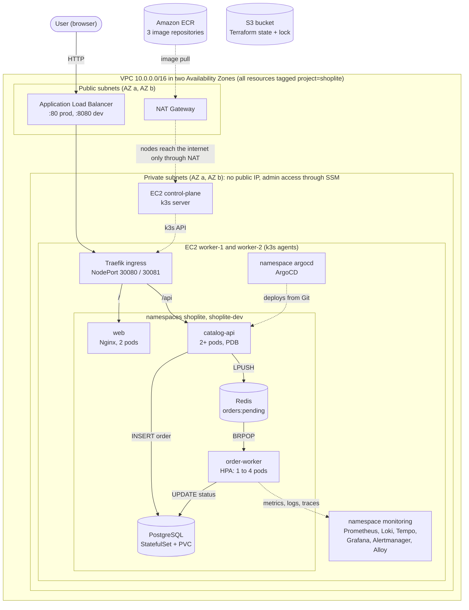
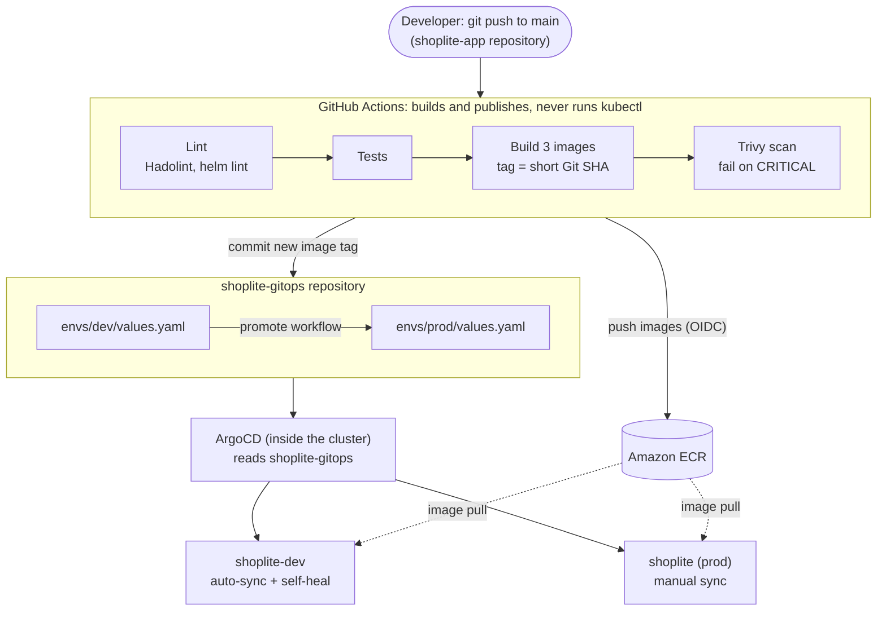
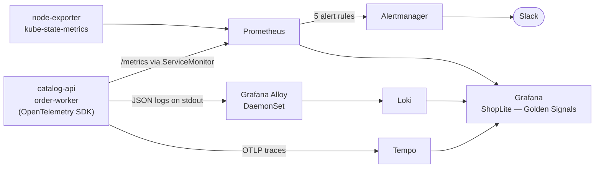

# ShopLite: Architecture diagram

এখানে তিনটা ছবি আছে:

1. Infrastructure আর application কোথায় বসে।
2. Code কীভাবে Git থেকে cluster-এ পৌঁছায়।
3. Metrics, log আর trace কীভাবে Grafana-য় আসে।

GitHub নিচের block-গুলো নিজে থেকেই ছবি হিসেবে দেখায়। প্রতিটার PNG একই folder-এ আছে: `architecture-diagram.png`, `architecture-delivery-flow.png`, `architecture-observability-flow.png`।

## ১. Infrastructure আর application

**একটা order-এর পথ**

1. Browser থেকে request যায় ALB-তে, সেখান থেকে worker node-এর Traefik-এ।
2. Traefik `/` পাঠায় `web`-এ, আর `/api` পাঠায় `catalog-api`-তে।
3. `catalog-api` order-টা `PENDING` অবস্থায় PostgreSQL-এ রাখে, তারপর Redis-এর `orders:pending` list-এ ঠেলে দেয়। Message-এর সাথে trace context-ও যায়।
4. `order-worker` list থেকে order তুলে `PROCESSING` করে, ১–২ সেকেন্ড কাজ করে, তারপর `COMPLETED` লেখে।
5. Browser `GET /api/orders/{id}` দিয়ে status দেখে।

**ছবিটা পড়ার সময় যা মনে রাখবে**

- prod চলে `shoplite` namespace-এ (ALB-র port 80), dev চলে `shoplite-dev`-এ (port 8080)। দুটোই একই cluster-এ।
- তিনটা EC2-ই private subnet-এ, কোনোটার public IP নেই। ভেতরে ঢোকার পথ SSM Session Manager।
- Internet থেকে শুধু ALB-তে পৌঁছানো যায়। Node-এর security group শুধু ALB থেকে ingress-এর port-এ traffic নেয়।
- Node বাইরে যায় শুধু NAT Gateway দিয়ে, যেমন ECR থেকে image টানতে।
- PostgreSQL আর Redis-এ ঢুকতে পারে শুধু `catalog-api` আর `order-worker` (NetworkPolicy)।
- Monitoring আর ArgoCD-ও worker node-এই চলে, আলাদা namespace-এ।

## ২. Delivery: push থেকে cluster

- Pipeline শুধু image বানায় আর publish করে। Cluster-এ কিছু বসায় ArgoCD, Git থেকে পড়ে।
- AWS-এ ঢোকার জন্য pipeline-এ কোনো স্থায়ী key নেই; প্রতিবার OIDC দিয়ে অল্প সময়ের credential নেয়।
- dev-এ নতুন tag নিজে থেকেই বসে। prod-এ তুলতে `promote` workflow, তারপর হাতে sync।
- কেউ `kubectl` দিয়ে dev-এ কিছু বদলালে ArgoCD সেটা Git-এর অবস্থায় ফিরিয়ে আনে।

## ৩. Observability: তিন ধরনের signal

**Grafana-র ভেতরে তিনটা signal যেভাবে জোড়া লাগে**

- Latency panel-এর exemplar বিন্দুতে click করলে ওই request-এর trace খোলে (Prometheus → Tempo)।
- Log-এর `trace_id` থেকে সরাসরি trace-এ যাওয়া যায় (Loki → Tempo)।
- Trace থেকে ওই trace-এর সব log দেখা যায় (Tempo → Loki)।

এই তিনটা link থাকলেই একটা alert থেকে শুরু করে ঠিক যে request-টা ব্যর্থ হয়েছে সেখানে দুই মিনিটের মধ্যে পৌঁছানো যায়।
