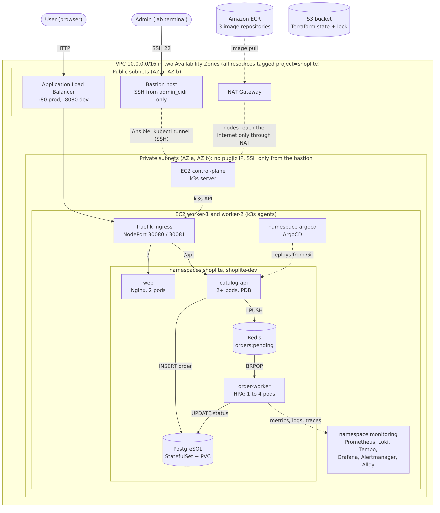

# ShopLite

ShopLite is a small e-commerce backend, built as the capstone of the "Mastering DevOps and
AWS" course (Poridhi, batch 03). Customers list products and place orders, and a worker
processes the orders in the background.

This repository holds:

- the application and its containers;
- the AWS infrastructure (Terraform, Ansible);
- the Helm chart;
- the monitoring configuration;
- the CI workflows.

Its companion, [shoplite-gitops](https://github.com/SaikatGeek/shoplite-gitops), holds the
ArgoCD Applications and each environment's values.



The delivery and observability flows are in
[docs/architecture-diagram.md](docs/architecture-diagram.md).

## The application

| Component | What it does | Code |
|---|---|---|
| web | Nginx serves the static page (list products, place an order, see its status) and proxies `/api/` to catalog-api | [services/web](services/web) |
| catalog-api | REST API, Python 3.12 and FastAPI | [services/catalog-api](services/catalog-api) |
| order-worker | Takes orders from the Redis list `orders:pending`, works 1–2 seconds on each, and writes its status | [services/order-worker](services/order-worker) |
| postgres | Products and orders, seeded with 12 products | [helm/shoplite/files/init.sql](helm/shoplite/files/init.sql), used by Compose and Kubernetes |
| redis | The queue `orders:pending` | |

catalog-api's endpoints. Through web, and through the Ingress, they are under `/api`:

| Method | Path | Answer |
|---|---|---|
| GET | `/products` | All products |
| GET | `/products/{id}` | One product, or 404 |
| POST | `/orders` | `{"product_id": 1, "quantity": 2}`: a `PENDING` order, put on the queue; 201 with its id |
| GET | `/orders/{id}` | Its status: `PENDING`, `PROCESSING`, `COMPLETED` or `FAILED` |
| GET | `/healthz` | Liveness: the process runs |
| GET | `/readyz` | Readiness: PostgreSQL and Redis answer |
| GET | `/metrics` | Prometheus metrics |

**Settings.** Both services:

- read their settings from environment variables only, and check them at start;
- log JSON lines on stdout with `timestamp`, `level`, `service`, `message` and `trace_id`.

On SIGTERM the worker takes no new order and finishes the ones in hand.

**Fault injection** (question 1.5, all off by default):

| Variable | Service | Effect |
|---|---|---|
| `CHAOS_LATENCY_MS` | catalog-api | Adds that many milliseconds to about 30% of `GET /products/{id}` |
| `CHAOS_ERROR_RATE` | catalog-api | Answers that fraction of `POST /orders` with 500 (`0.1` is 10%) |
| `CHAOS_MEMORY_LEAK` | order-worker | Keeps about 1 MB per processed order, never freed |
| `CHAOS_SLOW_DB` | order-worker | Runs `SELECT pg_sleep(2)` before each database update |

In Docker Compose they are set in `.env`. In Kubernetes they are set in shoplite-gitops'
`envs/<env>/values.yaml`, under `config.chaos` (`latencyMs`, `errorRate`, `memoryLeak`,
`slowDb`).

## Run it locally

You need Linux (or WSL) with Docker and its Compose plugin, `make` and `curl`.

```bash
git clone https://github.com/SaikatGeek/shoplite-app.git
cd shoplite-app
make up && make smoke
```

- `make up` copies `.env.example` to `.env` the first time. It then builds the three images,
  starts the five components and waits until all of them are healthy.
- `make smoke` runs [scripts/smoke-test.sh](scripts/smoke-test.sh). Through the web
  container, it waits for `/api/readyz`, places an order, and polls the order until it is
  `COMPLETED`. It exits non-zero if any step fails.
- The page is at http://localhost/ and the API under http://localhost/api/ (for example
  `/api/products`).
- Only web is published, on `WEB_PORT` from `.env` (default 80). If port 80 is taken, set,
  for example, `WEB_PORT=127.0.0.1:8088`.
- `make test` runs each service's unit tests in its Dockerfile's `test` stage. It takes a few
  minutes the first time.
- `make build` builds the images. `make down` stops the stack; the PostgreSQL volume `pgdata`
  stays.

## Repository layout

```text
services/                  web, catalog-api, order-worker: code, Dockerfile, .dockerignore, tests (Q1, Q2)
docker-compose.yml         the five components; named volume for PostgreSQL (Q2)
Makefile, .env.example     build, up, down, test, smoke (Q2)
scripts/smoke-test.sh      the smoke test (Q2)
linux/                     one hardened Ubuntu server: sshd_config, systemd backup, firewall, evidence (Q3)
terraform/                 AWS (Q4): bootstrap/ (state bucket), the root configuration,
                           modules/{network,compute,alb,ecr,github-oidc}, q3-server/
ansible/                   question 3's hardening on every node, and the k3s cluster (Q4)
helm/shoplite/             the Helm chart, values-dev.yaml, values-prod.yaml (Q5)
monitoring/                stack/ (chart values), dashboards/, alert-rules/, runbooks/ (Q6)
.github/workflows/         main, pr, terraform-plan, promote (Q7)
scripts/                   ci.sh (the pipelines' stages), update-gitops.sh, terraform-plan.sh,
                           bootstrap-cluster.sh, loadtest.js (k6), chaos-pick.sh (Q8)
docs/                      architecture diagram, RCA, evidence/ (each question's lab procedure)
```

`ansible/tests/`, `helm/tests/` and `scripts/tests/` hold the local rehearsals (see
[Tests](#tests)).

## How it runs in AWS

Everything is built from Git:

1. **Terraform** ([terraform/](terraform)) builds:
   - a VPC in two Availability Zones: two public and two private subnets, an Internet Gateway
     and one NAT Gateway;
   - three Ubuntu 24.04 nodes in the private subnets: one control plane and two workers.
     Admins reach them over SSH through a bastion host in a public subnet: the nodes accept
     SSH only from the bastion, and the bastion only from the admin's address;
   - the ALB: port 80 goes to prod, port 8080 to dev, both to Traefik's NodePorts;
   - the three ECR repositories, and the GitHub OIDC roles. Only this repository's `main`
     (the push) and its pull requests (the plan) can take them. GitHub's tokens name the
     repository by its owner's and its own numeric IDs (the subject GitHub gives repositories
     created after 15 July 2026), so `terraform/main.tf` pins both IDs;
   - the USD 20 budget.

   The state is in S3, with a lock file. Every resource is tagged `project=shoplite`.
2. **Ansible** ([ansible/](ansible)), over SSH through the bastion:
   - question 3's hardening on every node;
   - the k3s server and agents;
   - the kubeconfig.
3. **[scripts/bootstrap-cluster.sh](scripts/bootstrap-cluster.sh)**, once per cluster:
   - the namespaces;
   - the Secrets of the database, Grafana and Slack: random passwords, or the webhook you
     give it, never in Git;
   - ArgoCD;
   - the root Application from shoplite-gitops.
4. **ArgoCD** installs the rest from shoplite-gitops:
   - Traefik;
   - the monitoring stack: kube-prometheus-stack, Loki, Tempo, Grafana Alloy;
   - the dashboard and the alerts;
   - ShopLite in `shoplite-dev` (automatic sync, self-heal) and in `shoplite` (prod, manual
     sync).

   Both repositories are public, so ArgoCD reads them without credentials.
5. **GitHub Actions** ([.github/workflows/](.github/workflows)) never runs kubectl:
   - On every push to `main`:
     1. lint (Hadolint, `helm lint`);
     2. the tests;
     3. the images, tagged with the short commit SHA;
     4. the Trivy scan, which fails on CRITICAL;
     5. the push to ECR through OIDC, and the tag committed to dev's values in
        shoplite-gitops.
   - `promote` copies dev's image to prod's values.
   - Pull requests run the same checks. One that changes `terraform/` gets the plan as a
     comment.

The lab procedures, with the evidence to take at each step:

- question 3: [linux/evidence/commands.md](linux/evidence/commands.md);
- questions 4 to 8: [docs/evidence/](docs/evidence), one folder per question.

The workflows use these settings (Settings → Secrets and variables → Actions):

| Name | Kind | What |
|---|---|---|
| `LAB_ACTIVE` | variable | `true` during a lab session. Otherwise the steps that need AWS are skipped, and the runs stay green |
| `AWS_ROLE_ARN` | variable | main's role: `terraform output ci_role_arn` |
| `AWS_PLAN_ROLE_ARN` | variable | terraform-plan's read-only role: `terraform output ci_plan_role_arn` |
| `AWS_REGION` | variable | optional, default `ap-southeast-1` |
| `SSH_PUBLIC_KEY` | variable | the nodes' public key, for terraform-plan |
| `ADMIN_CIDR` | variable | the lab terminal's public IP as `x.x.x.x/32` (the same as `TF_VAR_admin_cidr`), for terraform-plan |
| `GITOPS_DEPLOY_KEY` | secret | a deploy key that can write to shoplite-gitops, for main and promote |
| `BUDGET_ALERT_EMAIL` | secret | the budget's e-mail address, for terraform-plan |

## Secrets

- `.env` is not in Git. `.env.example` has values for the local stack only.
- In Kubernetes these exist only in the cluster: the database credentials (Secret
  `shoplite-db`), Grafana's admin password, Alertmanager's Slack webhook and ArgoCD's admin
  password. The chart only refers to them by name.
- CI reaches AWS through OIDC, with no stored key.
- Terraform takes the budget's e-mail, the nodes' SSH key and the admin's address from
  `TF_VAR_` variables.

## Tests

| Command | What it checks | Time |
|---|---|---|
| `make test` | The three services' unit tests, in Docker | a few minutes |
| `bash monitoring/alert-rules/tests/run.sh` | The five alerts with promtool: names, severities, runbooks, when each fires | 10 s |
| `bash scripts/ci.sh lint`, `test`, `build <tag>`, `scan <tag>` | The pipelines' stages, as CI runs them | |
| The Terraform tests (below) | Every module and configuration, with a mock AWS provider | a few minutes |
| `bash ansible/tests/run.sh` | The playbook on three systemd containers: hardening, a k3s cluster, a second run with `changed=0` | 5–10 min |
| `bash scripts/tests/pipeline.sh` | The workflows (actionlint, pinned actions, triggers), `update-gitops.sh`, promote, `ci.sh`, `chaos-pick.sh` | 1–2 min |
| `bash helm/tests/run.sh` | The chart on a local k3s: both environments, orders, NetworkPolicy, HPA, PDB | 10–20 min |
| `bash scripts/tests/bootstrap-cluster.sh` | The GitOps bootstrap on a local k3s: ArgoCD, the monitoring stack, logs and traces, the dashboard, the alerts, self-heal | about 16 min |

All of them run in Docker. The first run of each downloads its images and tools from the
internet. The last three also need shoplite-gitops cloned next to this repository
(`../shoplite-gitops`).

The Terraform tests need no AWS account:

```bash
TF="docker run --rm -v $PWD/terraform:/tf -v shoplite-tf-cache:/cache -e TF_PLUGIN_CACHE_DIR=/cache -w /tf hashicorp/terraform:1.17.2"
$TF fmt -check -recursive
for dir in . bootstrap q3-server modules/network modules/compute modules/alb modules/ecr modules/github-oidc; do
  $TF -chdir=$dir init -backend=false -input=false >/dev/null && $TF -chdir=$dir test
done
```

## Evidence index

| Question | Marks | Code | Procedure and screenshots |
|---|---|---|---|
| Q1 Application | 8 | [services/](services), with the tests in `services/*/tests/` | The tests run in every CI run (`scripts/ci.sh test`) |
| Q2 Docker | 10 | Dockerfiles, `.dockerignore`, [docker-compose.yml](docker-compose.yml), [scripts/smoke-test.sh](scripts/smoke-test.sh), [Makefile](Makefile) | `make up && make smoke` on a clean machine: [linux/evidence/commands.md](linux/evidence/commands.md) |
| Q3 Linux | 5 | [linux/](linux) | [linux/evidence/commands.md](linux/evidence/commands.md) |
| Q4 AWS and IaC | 17 | [terraform/](terraform), [ansible/](ansible) | [docs/evidence/q4/commands.md](docs/evidence/q4/commands.md) |
| Q5 Kubernetes | 15 | [helm/shoplite/](helm/shoplite); Traefik in shoplite-gitops | [docs/evidence/q5/commands.md](docs/evidence/q5/commands.md) |
| Q6 Observability | 25 | [monitoring/](monitoring); the services' metrics, logs and traces | [docs/evidence/q6/commands.md](docs/evidence/q6/commands.md) |
| Q7 CI/CD and GitOps | 10 | [.github/workflows/](.github/workflows), [scripts/ci.sh](scripts/ci.sh), [scripts/update-gitops.sh](scripts/update-gitops.sh), [terraform/modules/github-oidc/](terraform/modules/github-oidc), shoplite-gitops | [docs/evidence/q7/commands.md](docs/evidence/q7/commands.md) |
| Q8 Chaos and RCA | 10 | The fault-injection settings (question 1.5), [scripts/chaos-pick.sh](scripts/chaos-pick.sh) | [docs/evidence/q8/commands.md](docs/evidence/q8/commands.md), [docs/RCA.md](docs/RCA.md) |

## Deviations and choices

Where the build differs from the question's words, or a choice needs a reason:

- **No domain.** So there is no Route 53 record and no HTTPS.
  - The environments are told apart by the ALB's port: 80 is prod, 8080 is dev.
  - ArgoCD and Grafana are at `/argocd/` and `/grafana/` on port 80, each behind its own
    login.
- **Self-healing is shown in dev.** Prod needs a manual sync (question 7c), and ArgoCD
  self-heals only with automatic sync. Dev has both.
- **ArgoCD counts every Ingress as Healthy.** Traefik sits behind NodePorts, and the ALB
  comes from Terraform, so an Ingress never gets a load-balancer address. Without this
  health check every Application would stay Progressing.
- **The container runtime is the containerd inside k3s.** Ansible prepares the kernel
  (`overlay`, `br_netfilter`, sysctls) and installs the pinned k3s binary after checking its
  checksum. There is no separate containerd package and no install script.
- **The nodes' firewall** has question 3's UFW rules (22, 80 and 443 in, everything else
  denied), plus what the cluster needs:
  - from the VPC: 8472/udp, 10250 and 9100, and 6443 on the control plane;
  - everything from the k3s pod and service networks;
  - routed traffic, for the NodePorts.

  The security groups open port 22 on the nodes only to the bastion's group, and on the
  bastion only to `admin_cidr`.
- **ECR images are pulled through kubelet's credential provider**, with the node's IAM
  role. So there is no image pull secret to renew.
- **Question 3's server has a small VPC of its own** (`terraform/q3-server`). Its security
  group admits only the admin's network, on 22, 80, 443 and 8000. With 8000 open there, the
  port that question 3.4 shows as blocked is blocked by UFW alone.
- **The pipelines reach AWS only during a lab session** (`LAB_ACTIVE=true`).
  - Outside one, main still lints, tests, builds and scans, and stays green; terraform-plan
    prints a notice.
  - main also has a "Run workflow" button, because each session starts with an empty ECR.
- **Prod gets an image only from dev.** The `promote` workflow copies dev's registry and tag
  into prod's values, and prod is then synced by hand.
- **Docker Compose has no trace backend.** It runs exactly question 2's five components.
  Spans are still created, and every log line has its `trace_id`. They are exported in
  Kubernetes, to Tempo.
- **An order does not change the product's stock.** The question does not ask for it, and
  question 8's load test would empty the stock and fail every order.
- **The dashboard** has question 6.3's seven displays, plus an "Investigation" row for
  question 8, where kubectl is not used:
  - restarted containers, with the last termination reason;
  - recent error logs;
  - deploy marks on every graph.
- **The alerts:**
  - HighErrorRate and HighLatency are evaluated per environment and route.
  - NodeDiskFilling watches `/` for 5 minutes; the question gives no duration.
  - PodCrashLooping fires on the first restart.
- **web's image patches its base image**, because the Trivy gate rejects CRITICAL findings
  and no build of `nginx-unprivileged:1.30.6-alpine` has the fixes yet:
  - `brotli-libs=1.2.1-r0` (1.2.0-r1 has CVE-2026-111497);
  - nginx 1.30.7-r1 and the image's modules from nginx.org's own Alpine repository (1.30.6
    has CVE-2026-113425, CVE-2026-121810, CVE-2026-123007 and CVE-2026-123633).

  The tests run on the patched image too. Remove each line once the base image has its fix.
- **Admin access is through a bastion host, not SSM.** The question prefers SSM, and the
  nodes are set up for it (agent and role). But the lab account's organization policy denies
  `ssmmessages` to the instances, so Session Manager answers `TargetNotConnected`. The
  question's other option is used instead:
  - a t3.micro in a public subnet, with no IAM role;
  - SSH in only from `admin_cidr` (`TF_VAR_admin_cidr`, the lab terminal's address), and out
    only to the nodes' port 22;
  - Ansible and the kubectl tunnel (an SSH port forward to the control plane) go through it.
- **The lab account denies some read-only APIs**, so the evidence uses others:
  - `tag:GetResources`: the tagged resources come from `aws ec2 describe-tags`;
  - CloudTrail's `LookupEvents`.
- **Question 8 runs without a peer**, at the instructor's request (24 Nov). The question lets
  "a peer or the instructor" turn the fault on; [scripts/chaos-pick.sh](scripts/chaos-pick.sh)
  plays that part:
  - it turns one of the four faults on in prod, chosen at random, with GitHub's default
    commit message;
  - it never prints which, so the investigation stays blind;
  - the RCA is committed before the change is read.
- **Question 8's load test runs for up to an hour**, at 22 requests a second. The question's
  15 minutes at 20 or more fall inside one run, which also shows the healthy start and the
  recovery.
- **There is no one-command lab script.** Each question's procedure in `docs/evidence/` lists
  the commands step by step, with what each should show.
