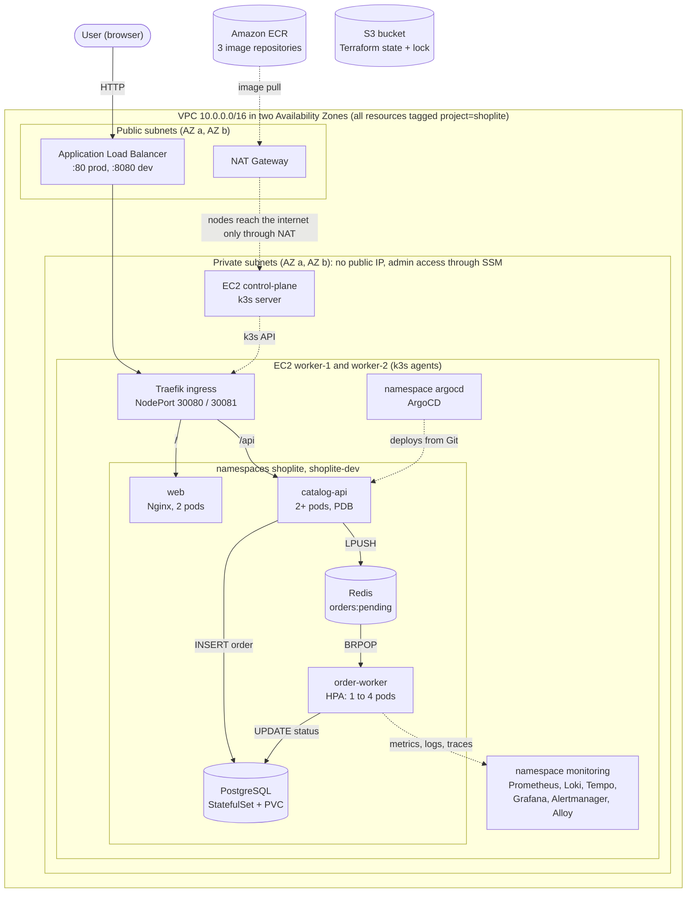
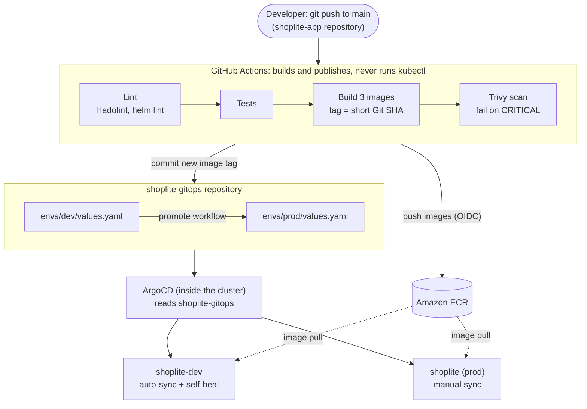
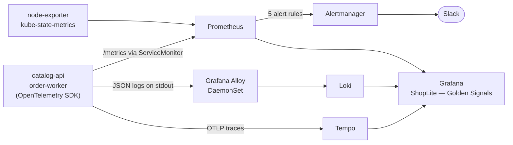

# ShopLite: architecture diagram

Three pictures:

1. Where the infrastructure and the application run.
2. How code goes from Git to the cluster.
3. How metrics, logs and traces reach Grafana.

GitHub draws the blocks below as pictures. Each also exists as a PNG in this folder:
`architecture-diagram.png`, `architecture-delivery-flow.png`,
`architecture-observability-flow.png`.

## 1. Infrastructure and application

**The path of one order**

1. The browser's request reaches the ALB, which sends it to Traefik on a worker node.
2. Traefik sends `/` to `web` and `/api` to `catalog-api`.
3. `catalog-api` stores the order in PostgreSQL as `PENDING`, then pushes it onto Redis's
   `orders:pending` list. The trace context travels inside the message.
4. `order-worker` takes the order from the list, sets it to `PROCESSING`, works for 1–2
   seconds, then writes `COMPLETED`.
5. The browser reads the status with `GET /api/orders/{id}`.

**Reading the picture**

- Prod runs in the namespace `shoplite` (ALB port 80), dev in `shoplite-dev` (ALB port
  8080), both in the same cluster.
- The three EC2 instances are in private subnets, without public IPs. Administrators reach
  them through SSM Session Manager.
- From the internet only the ALB can be reached. The nodes accept the ingress NodePorts only
  from the ALB.
- The nodes go out only through the NAT Gateway, for example to pull images from ECR.
- Only `catalog-api` and `order-worker` can reach PostgreSQL and Redis (NetworkPolicy).
- Monitoring and ArgoCD run on the worker nodes too, each in its own namespace.

## 2. Delivery: from a push to the cluster

- The pipeline only builds and publishes images. ArgoCD installs everything in the cluster,
  from Git.
- The pipeline holds no long-lived AWS key: every run gets short-lived credentials through
  OIDC.
- A new tag reaches dev on its own. Prod gets it through the `promote` workflow and a manual
  sync.
- If someone changes dev with `kubectl`, ArgoCD puts it back to the state in Git.
- Pull requests run the same lint, tests, build and scan, without AWS. A pull request that
  changes `terraform/` also gets the Terraform plan as a comment, through a read-only role.

## 3. Observability: three kinds of signal

**How Grafana joins the three signals**

- A click on an exemplar dot of the latency panel opens that request's trace (Prometheus →
  Tempo).
- A log line's `trace_id` opens its trace (Loki → Tempo).
- A trace shows all the log lines of that trace (Tempo → Loki).

With these three links, a reviewer goes from an alert to the exact request that failed in
under two minutes.
